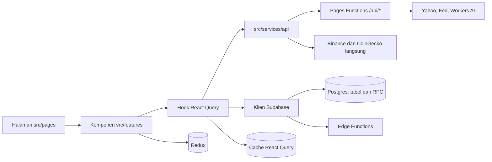
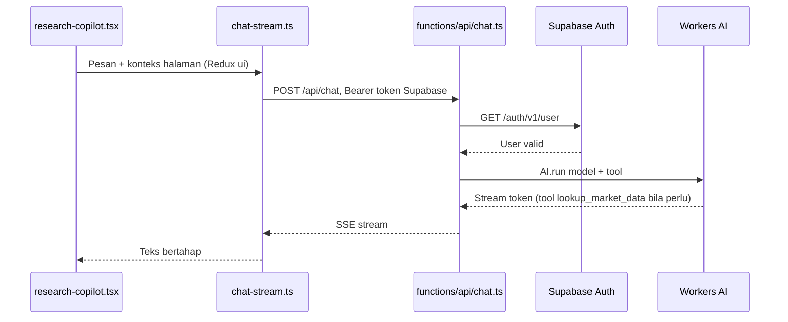
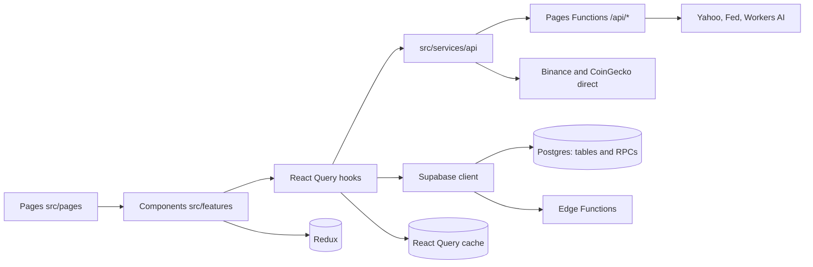
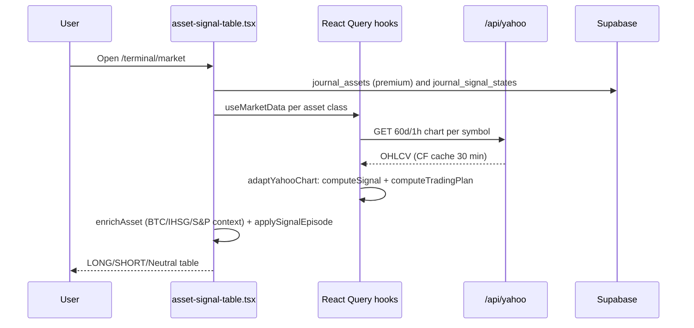
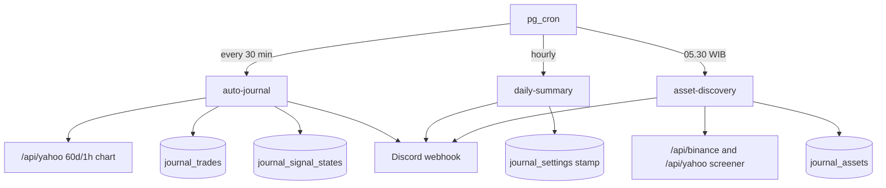

# TSD 09 — Alur Aplikasi per Halaman / Application Flow per Page

> Status: Kanonis
> Terverifikasi: 2026-10-15
> Tanggal: 2026-10-15
> Cakupan: Low-Level Design (LLD): halaman → komponen → hook → service → penyimpanan, plus cron server

[Bahasa Indonesia](#bagian-id) · [English](#english-part)

## Bagian ID

### Ringkasan
- Dokumen ini adalah Low-Level Design: tiap halaman ditelusuri sampai file, endpoint, dan tempat datanya disimpan.
- Gambaran besar ada di `00-architecture.md` dan `02-data-flow.md`; dokumen ini versi detailnya.
- Semua path file relatif ke root repo. Nama tabel dan RPC sama persis dengan Supabase.

### Cara Membaca Tabel
| Kolom | Isi |
|---|---|
| Langkah | Aksi user atau proses otomatis, berurutan |
| File | Komponen, hook, atau modul yang menjalankan langkah |
| Service | Endpoint, RPC, atau fungsi murni yang dipanggil |
| Data ditampung di | Tempat hasilnya disimpan |

Kode penyimpanan:
- **RQ `[key]`**: cache React Query di memori tab browser, hilang saat tab ditutup.
- **Redux `slice`**: store global `ui`, `filter`, `auth` (`src/store`).
- **LS `key`**: localStorage browser.
- **DB `tabel`**: Postgres Supabase, dilindungi RLS.
- **CF Cache**: Cache API Cloudflare per URL di proxy `/api/*`.
- **Memori**: state React atau `useMemo`, tidak dipersist.

### Peta Lapisan

- Halaman tidak pernah fetch langsung; selalu lewat hook di `src/features/*/hooks` atau `src/services/queries`.
- Proxy Cloudflare memakai `functions/api/_shared/proxy.ts` (cache fresh/stale/error per route).
- Engine (`src/core`) murni tanpa IO; dipanggil di dalam `queryFn` atau `useMemo`.

### 0. Shell Global (Semua Halaman)
| Langkah | File | Service | Data ditampung di |
|---|---|---|---|
| Boot app | `src/main.tsx`, `src/app/providers/index.tsx` | Default query: stale 5 menit, refetch 5 menit, retry 1 | RQ client, Redux store |
| Bahasa | `src/app/config/i18n.ts` | i18next + language detector | LS `i18nextLng` |
| Tema | `src/components/theme-provider.tsx` | none | LS kunci tema |
| Sesi login | `src/features/auth/hooks/use-auth.ts` | `supabase.auth.getSession`, `onAuthStateChange` | Redux `auth` (session, user, ready); token di LS milik Supabase |
| Logout | `use-auth.ts` | `supabase.auth.signOut` | Hapus RQ `profile`, `journal-trades`, `screener-universe`, `journal-assets`, `admin-users`, `admin-access-codes` |
| Aktivitas sesi | `src/app/hooks/use-session-activity.ts` | RPC `touch_last_active` | LS waktu aktif terakhir, DB `profiles.last_active_at` |
| Ticker header | `src/components/layout/market-ticker.tsx` | `useMarketData(MARKET_INDICES)` → `/api/yahoo/v8/finance/chart` | RQ `["asset-data", simbol, "60d", "1h"]`, CF Cache 30 menit |
| Widget Sensei | `src/features/chat/components/research-copilot.tsx` | Lihat bagian 10 | Memori (riwayat chat), Redux `ui` |

Detail `useMarketData` (`src/services/queries/use-market-data.ts`), dipakai hampir semua halaman:
1. `fetchYahooChart` (`src/services/api/yahoo-finance.ts`) → `GET /api/yahoo/v8/finance/chart/{simbol}?range=60d&interval=1h`.
2. `functions/api/yahoo/[[path]].ts` meneruskan ke `query1.finance.yahoo.com`, cache chart fresh 30 menit, stale 6 jam.
3. `adaptYahooChart` (`src/services/adapters/yahoo-adapter.ts`) menormalisasi candle, menjalankan `computeSignal` dan `computeTradingPlan`.
4. Hasil `UnifiedAsset` (harga, outlook, trading plan) disimpan di RQ `["asset-data", simbol, "60d", "1h"]`, refetch 30 menit, retry 3. Simbol yang sama di halaman lain memakai cache yang sama.

### 1. Landing `/`
| Langkah | File | Service | Data ditampung di |
|---|---|---|---|
| Render halaman | `src/pages/landing.tsx` | none | Memori |
| Testimoni unggulan | `src/features/testimonials/components/testimonial-section.tsx` → `use-testimonials.ts` | `select featured_testimonials` | RQ `["featured-testimonials"]` |
| Kirim testimoni (login) | `src/features/testimonials/components/user-testimonial-dialog.tsx` → `useMyTestimonial` | `insert`/`update testimonial_submissions` | DB `testimonial_submissions`, RQ `["my-testimonial", userId]` |

### 2. Login, Register, Callback OAuth
| Langkah | File | Service | Data ditampung di |
|---|---|---|---|
| Login email | `src/pages/login.tsx` → `use-auth.ts › signIn` | `supabase.auth.signInWithPassword` | Redux `auth`, sesi Supabase di LS |
| Daftar | `src/pages/register.tsx` → `signUp` | `supabase.auth.signUp`; trigger `on_auth_user_created` → `handle_new_user()` | DB `auth.users`, DB `profiles` (tier `free`) |
| Login Google | `src/features/auth/components/google-auth-button.tsx` | `supabase.auth.signInWithOAuth` → Google → `/auth/callback` | Sesi Supabase |
| Callback | `src/pages/auth-callback.tsx` | Menunggu Redux `auth`, lalu `navigate(redirect)` | Redux `auth` |
| Redirect aman | `src/lib/auth-redirect.ts › sanitizeInternalRedirect` | Murni | Query `?redirect=` |

### 3. Terminal Pasar `/terminal`, `/terminal/market`

| Langkah | File | Service | Data ditampung di |
|---|---|---|---|
| Gate disclaimer | `src/pages/terminal.tsx` → `src/features/auth/hooks/use-disclaimer.ts` | `select disclaimer`, `select disclaimer_agreements` | RQ `["disclaimer-agreement", userId]`; anonim di LS `rabalaba_disclaimer_agreed` |
| Setuju disclaimer | `src/features/market/components/risk-disclaimer-dialog.tsx` → `agree()` | `insert disclaimer_agreements` | DB `disclaimer_agreements` atau LS (anonim) |
| Cek premium | `src/features/auth/hooks/use-premium-access.ts` | `select profiles` | RQ `["profile", userId]` |
| Ringkasan pasar | `src/features/market/components/market-summary-row.tsx` | `useMarketData` 8 simbol (BTC, ETH, ^JKSE, USDIDR, ^GSPC, ^VIX, DXY, emas) + `useMarketContexts` | RQ `asset-data`, RQ `["market-context", ...]` |
| Konteks kripto | `src/services/queries/use-crypto-context.ts` | Chart BTC + `src/services/api/coingecko.ts` langsung ke `api.coingecko.com` | RQ `asset-data`, RQ `["dominance"]` (30 menit) |
| Konteks IDX dan AS | `use-idx-context.ts`, `use-us-context.ts` | Chart ^JKSE + USDIDR; ^GSPC + ^VIX + DX-Y.NYB | RQ `asset-data` |
| Universe aset | `src/features/market/hooks/use-screener-universe.ts` | Premium: `select journal_assets`; gratis: `DEFAULT_*` di `src/constants/assets.ts` | RQ `["screener-universe", userId]` |
| Data per aset | `src/features/market/components/asset-signal-table.tsx` → `useMarketData` | Chart per simbol (kripto, saham AS, saham ID, komoditas, forex, favorit) | RQ `asset-data` |
| Status episode | `src/features/market/hooks/use-signal-episode-states.ts` | `select journal_signal_states` (publik, poll 60 detik) | RQ `["signal-episode-states"]` |
| Win rate publik | `use-public-journal-success-rates.ts` | RPC `get_public_journal_success_rates` | RQ `["public-journal-success-rates"]` (5 menit) |
| Favorit | `src/features/market/hooks/use-favorites.ts` | `select`/`insert`/`delete user_favorites` | DB `user_favorites`, RQ `["favorites", userId]` |
| Gabung sinyal | `asset-signal-table.tsx` | `enrichAsset` (`src/core/engine/enrichment.ts`) + `applySignalEpisode` (`src/core/automation/signal-episode.ts`) | Memori (`useMemo`) |
| Filter dan cari | `asset-signal-table.tsx` | none | Redux `filter` (assetType, signalFilter, searchQuery) |
| Tambah aset | `src/features/market/components/signal-asset-dialog.tsx` | `useYahooSearch` → `/api/yahoo/v1/finance/search` | RQ `["yahoo-search", q]`, DB `user_favorites` |

Dialog aset `?symbol=` (`src/features/trading-plan/components/asset-detail-dialog.tsx`, deep link via `src/hooks/use-dialog-param.ts`):

| Langkah | File | Service | Data ditampung di |
|---|---|---|---|
| Data aset | `asset-detail-dialog.tsx` | `useMarketData([simbol])` | RQ `asset-data` (biasanya sudah ada) |
| Fundamental saham | `src/services/queries/use-fundamentals.ts` | `/api/yahoo/v10/finance/quoteSummary` (cache CF 6 jam) | RQ `["fundamentals", simbol]` (1 hari) |
| Smart money kripto | `src/services/queries/use-smart-money.ts` → `src/services/api/binance.ts` | Langsung ke `fapi.binance.com`: premiumIndex, openInterestHist, globalLongShortAccountRatio | RQ `["smart-money", simbol]` (30 menit) |
| Backtest | `src/features/trading-plan/hooks/use-asset-backtest.ts` | Web Worker `backtest.worker.ts` → `runBacktest` (exit scaleOut) | RQ `["asset-backtest", simbol, timeframe, dataUpdatedAt]` |
| Bagikan setup | `src/features/trading-plan/hooks/use-share-setup.ts` | Canvas (`share-card.ts`), unduh atau share sistem | File gambar di perangkat user |
| Tanya Sensei | `asset-detail-dialog.tsx` | `dispatch` konteks riset | Redux `ui.activeResearchContext` |

### 4. Terminal Jurnal `/terminal/journal` (Premium)
| Langkah | File | Service | Data ditampung di |
|---|---|---|---|
| Gate akses | `src/pages/terminal.tsx` | `usePremiumAccess`; RLS `is_premium()` di tabel | RQ `["profile", userId]` |
| Periode jurnal | `src/features/journal/hooks/use-journal-period.ts` | RPC `get_journal_period_config` | RQ `["journal-period-config", userId]` (5 menit) |
| Daftar trade | `src/features/journal/hooks/use-journal-trades.ts` | `select journal_trades` (semua open + closed dalam periode) | RQ `["journal-trades", userId, scope, start, end]` (poll 60 detik) |
| Mapping baris | `src/core/trade/journal-mapper.ts › rowToFollowedTrade` | Murni | Memori |
| Statistik dan chart | `src/features/journal/components/journal-dashboard.tsx` | `buildTrackerStats`, `journal-performance.ts`; acuan BTC dan emas via `fetchYahooChart` | RQ `["journal-benchmark", simbol, range, interval]` |
| Performa aset | `src/features/journal/components/top-performers.tsx` | `computePnl` | Memori |
| Tabel riwayat | `src/features/follow-trade/components/follow-history-table.tsx` | `deriveFollowProgress`, `tradeOutcomeBucket` | Memori |
| Dialog trade `?trade=` | `src/features/follow-trade/components/trade-detail-dialog.tsx` | `useJournalTrade(id)` → `select journal_trades where id`; candle via `usePeriodCandles` → `/api/yahoo` dengan `period1`/`period2` | RQ `["journal-trade", id, userId]`, RQ `["period-candles", ...]` (tidak kedaluwarsa) |

Penulis `journal_trades` hanya cron `auto-journal` (bagian 12). Browser cuma membaca.

### 5. Kalender Ekonomi `/calendar`
| Langkah | File | Service | Data ditampung di |
|---|---|---|---|
| Muat bulan | `src/pages/calendar.tsx` → `src/services/queries/use-calendar-data.ts` | `src/services/api/calendar.ts` → `GET /api/calendar/fed?month=` dan `/api/calendar/yahoo?month=` | RQ `["economic-calendar", "YYYY-MM"]` (30 menit) |
| Proxy sumber | `functions/api/calendar/[source].ts` | Fed `calendar.json`; Yahoo visualization API (crumb di `functions/api/_shared/yahoo.ts`) | CF Cache per bulan |
| Normalisasi | `src/features/economic-calendar/model/calendar.ts` | Murni (merge, filter mata uang) | Memori |
| Detail event | `src/features/economic-calendar/components/calendar-detail-dialog.tsx` | none | Memori |

### 6. Kalkulator `/calculator`
| Langkah | File | Service | Data ditampung di |
|---|---|---|---|
| Hitung risiko | `src/pages/calculator.tsx` → `src/features/learn/components/risk-calculator.tsx` | Murni, tanpa network | Memori |

### 7. Edukasi `/learn`
| Langkah | File | Service | Data ditampung di |
|---|---|---|---|
| Tab dan deep link | `src/pages/learn.tsx` → `src/features/learn/components/learn-content.tsx` | `?tab=`, `?pattern=`, `?strategy=` | URL |
| Konten | `src/features/learn/data/*.ts` | Data statis di bundle | Memori |
| Simulator dan kuis | `candlestick-simulator.tsx`, `chart-pattern-simulator.tsx`, `interactive-quiz.tsx` | Murni | Memori |

### 8. Langganan `/subscription`
| Langkah | File | Service | Data ditampung di |
|---|---|---|---|
| Daftar paket | `src/pages/subscription.tsx` → `src/features/management/hooks/use-subscription-plans.ts` | `select subscription_plans` | RQ `["subscription-plans"]` |
| Cara bayar | `src/features/market/components/user-payment-dialog.tsx` → `use-payment-methods.ts` | `select payment_methods`; konfirmasi manual via Telegram | RQ `["payment-methods"]` |
| Tukar kode akses | `src/components/shared/license-access-dialog.tsx` → `usePremiumAccess` | RPC `redeem_access_code` | DB `profiles` (tier, trial_expires_at), DB `code_redemptions` |

### 9. Undangan `/invite/:code`
| Langkah | File | Service | Data ditampung di |
|---|---|---|---|
| Cek kode | `src/pages/invite.tsx` → `src/features/auth/hooks/use-invitation.ts › useInvitationPeek` | RPC `peek_invitation` | RQ `["invitation-peek", code]` |
| Klaim | `useInvitation` | RPC `redeem_invitation` | DB `profiles`, DB `invitation_redemptions` |
| Belum login | `invite.tsx` | Link `/login?redirect=/invite/{code}` | URL |

### 10. Research Copilot (Sensei)

| Langkah | File | Service | Data ditampung di |
|---|---|---|---|
| Konteks | `src/features/chat/terminal-context-builders.ts`, `market-context.ts` | Dari Redux `ui.activeResearchContext` / `activePageContext` | Redux `ui` |
| Kirim | `src/features/chat/chat-stream.ts › streamChat` | `POST /api/chat` (maks 20 pesan, 16.000 karakter) | Memori |
| Auth | `functions/api/chat.ts › authenticate` | `GET {SUPABASE_URL}/auth/v1/user` | none |
| Inferensi | `functions/api/chat.ts` | `env.AI.run` model Workers AI, tool `calculate_trading_metrics` dan `lookup_market_data` | none (`store: false`) |
| Data pasar tool | `functions/api/chat-market-data.ts` | Langsung ke `query1.finance.yahoo.com` (search + chart) → `adaptYahooChart` | none |
| Riwayat chat | `research-copilot.tsx` | Session store di `useMemo` | Memori, hilang saat reload |

### 11. Admin `/admin/*` (Admin dan Owner)
Gate: `src/app/layouts/admin-layout.tsx` memakai `usePremiumAccess().isAdmin`; selain admin diarahkan ke `/`. Semua RPC `admin_*` mengecek `is_admin()` di database.

| Halaman | File | Service | Data ditampung di |
|---|---|---|---|
| Statistik `/admin/statistics` | `src/pages/management/statistics.tsx` | `useAdminUsers`, `useJournalAssets`, `useJournalSettings`, `useJournalTrades` | RQ masing masing |
| Pengaturan robot | `src/features/management/components/journal-settings-dialog.tsx` → `use-journal-settings.ts` | `update journal_settings`; RPC `admin_start_new_journal_period` | DB `journal_settings` |
| Scan Sekarang | `src/features/management/hooks/use-market-scan.ts` | `supabase.functions.invoke("auto-journal", { force: true })` | DB `journal_trades`, `journal_signal_states`; invalidasi RQ `journal-trades`, `asset-data` |
| Discovery manual | `use-asset-discovery.ts` | `supabase.functions.invoke("asset-discovery")` | DB `journal_assets` |
| Aset `/admin/assets` | `src/pages/management/assets.tsx` → `use-journal-assets.ts` | Validasi `fetchYahooChart`; `insert`/`update`/`delete journal_assets` | DB `journal_assets`, RQ `["journal-assets", userId]` |
| Pengguna `/admin/users` | `use-admin-users.ts` | RPC `admin_list_users`, `admin_create_user`, `admin_update_user`, `admin_toggle_block_user`, `admin_delete_user` | DB `auth.users`, `profiles` |
| Kode akses `/admin/codes` | `use-admin-users.ts` | RPC `admin_list_access_codes`, `admin_create_access_code`, `admin_delete_access_code` | DB `access_codes` |
| Undangan `/admin/invitations` | `use-admin-invitations.ts` | RPC `admin_list_invitations`, `admin_create_invitation`, `admin_revoke_invitation`, `admin_delete_invitation` | DB `invitations` |
| Paket `/admin/plans` | `use-subscription-plans.ts` | CRUD `subscription_plans` | DB `subscription_plans` |
| Pembayaran `/admin/payments` | `use-payment-methods.ts` | CRUD `payment_methods` | DB `payment_methods` |
| Disclaimer `/admin/disclaimer` | `disclaimer-editor.tsx` → `use-disclaimer.ts › update` | `update disclaimer` (naik versi); hitung `disclaimer_agreements` | DB `disclaimer` |
| Testimoni `/admin/testimonials` | `use-admin-testimonials.ts` | `update`/`delete testimonial_submissions`; RPC `admin_set_featured_testimonial`, `admin_unfeature_testimonial` | DB `testimonial_submissions`, `featured_testimonials`; jumlah slot di LS `admin_testimonial_max_slots` |

### 12. Proses Server Tanpa Halaman (Cron)

| Proses | File | Membaca | Menulis |
|---|---|---|---|
| auto-journal | `supabase/functions/auto-journal/index.ts` + core `src/core/automation/auto-journal-core.ts` | `journal_settings`, `journal_trades` (open), `journal_signal_states`, `journal_assets` (aktif), chart via proxy | `journal_trades` (insert, update TP/close), `journal_signal_states` (upsert), slot `journal_settings.last_run_at` via RPC `claim_auto_journal_slot`, Discord |
| daily-summary | `supabase/functions/daily-summary/index.ts` | `journal_settings`, `journal_trades` | Stamp rekap di `journal_settings`, Discord |
| asset-discovery | `supabase/functions/asset-discovery/index.ts` + core `asset-discovery-core.ts` | `journal_settings`, `journal_assets`, `journal_trades` (open); Binance 24h, Yahoo most actives, screener IDX via proxy | `journal_assets` (insert, reactivate, refresh, prune), `journal_settings.discovery_last_run_at`, Discord |

- Engine yang dipakai cron sama dengan browser: `src/core/edge-engine.ts` dibundel ke `_engine.mjs` oleh `npm run build:edge`.
- Jadwal ada di `supabase/schedule-*.sql`; detail gating di `05-edge-functions.md`.

### 13. Ringkasan Penyimpanan
| Tabel | Ditulis oleh | Dibaca oleh |
|---|---|---|
| `profiles` | Trigger signup, RPC redeem, RPC admin, `touch_last_active` | `use-premium-access.ts`, admin |
| `journal_trades` | Cron auto-journal | Jurnal, statistik admin, daily-summary, RPC win rate publik |
| `journal_signal_states` | Cron auto-journal | Terminal Pasar (publik) |
| `journal_assets` | Admin, cron asset-discovery | Terminal Pasar (premium), cron |
| `journal_settings` | Admin, ketiga cron | Admin, ketiga cron, RPC periode |
| `user_favorites` | User | Terminal Pasar |
| `disclaimer`, `disclaimer_agreements` | Admin; user saat setuju | Gate Terminal |
| `access_codes`, `code_redemptions` | Admin; RPC redeem | RPC redeem, admin |
| `invitations`, `invitation_redemptions` | Admin; RPC redeem | RPC peek dan redeem |
| `subscription_plans`, `payment_methods` | Admin | Halaman Langganan |
| `testimonial_submissions`, `featured_testimonials` | User; admin | Landing, admin |

| Penyimpanan browser | Isi |
|---|---|
| Redux `auth` | Session dan user Supabase, flag `ready` |
| Redux `filter` | Filter tabel Pasar |
| Redux `ui` | Loading halaman, konteks riset Sensei, id sesi chat |
| LS | Bahasa, tema, sesi Supabase, waktu aktif terakhir, disclaimer anonim, slot testimoni admin |

### Terkait
- Arsitektur: `00-architecture.md`. Alur data ringkas: `02-data-flow.md`.
- Skema dan RLS: `03-database-schema.md`. Proxy: `04-cloudflare-proxy.md`.
- Cron: `05-edge-functions.md`. Diagram sinyal: `08-signal-flow-diagrams.md`.

---

## English Part

### Summary
- This document is the Low-Level Design: each page is traced down to files, endpoints, and where its data is stored.
- The big picture lives in `00-architecture.md` and `02-data-flow.md`; this is the detailed version.
- All file paths are relative to the repo root. Table and RPC names match Supabase exactly.

### Reading the Tables
| Column | Content |
|---|---|
| Step | User action or automated process, in order |
| File | Component, hook, or module running the step |
| Service | Endpoint, RPC, or pure function called |
| Stored in | Where the result is kept |

Storage codes:
- **RQ `[key]`**: React Query cache in the browser tab's memory, gone when the tab closes.
- **Redux `slice`**: global `ui`, `filter`, `auth` store (`src/store`).
- **LS `key`**: browser localStorage.
- **DB `table`**: Supabase Postgres, protected by RLS.
- **CF Cache**: Cloudflare Cache API per URL in the `/api/*` proxy.
- **Memory**: React state or `useMemo`, never persisted.

### Layer Map

- Pages never fetch directly; they always go through hooks in `src/features/*/hooks` or `src/services/queries`.
- The Cloudflare proxy uses `functions/api/_shared/proxy.ts` (fresh/stale/error cache per route).
- The engine (`src/core`) is pure with no IO; it runs inside a `queryFn` or `useMemo`.

### 0. Global Shell (Every Page)
| Step | File | Service | Stored in |
|---|---|---|---|
| App boot | `src/main.tsx`, `src/app/providers/index.tsx` | Query defaults: stale 5 min, refetch 5 min, retry 1 | RQ client, Redux store |
| Language | `src/app/config/i18n.ts` | i18next + language detector | LS `i18nextLng` |
| Theme | `src/components/theme-provider.tsx` | none | LS theme key |
| Login session | `src/features/auth/hooks/use-auth.ts` | `supabase.auth.getSession`, `onAuthStateChange` | Redux `auth` (session, user, ready); token in Supabase's LS |
| Logout | `use-auth.ts` | `supabase.auth.signOut` | Removes RQ `profile`, `journal-trades`, `screener-universe`, `journal-assets`, `admin-users`, `admin-access-codes` |
| Session activity | `src/app/hooks/use-session-activity.ts` | RPC `touch_last_active` | LS last-active time, DB `profiles.last_active_at` |
| Header ticker | `src/components/layout/market-ticker.tsx` | `useMarketData(MARKET_INDICES)` → `/api/yahoo/v8/finance/chart` | RQ `["asset-data", symbol, "60d", "1h"]`, CF Cache 30 min |
| Sensei widget | `src/features/chat/components/research-copilot.tsx` | See section 10 | Memory (chat history), Redux `ui` |

`useMarketData` details (`src/services/queries/use-market-data.ts`), used by almost every page:
1. `fetchYahooChart` (`src/services/api/yahoo-finance.ts`) → `GET /api/yahoo/v8/finance/chart/{symbol}?range=60d&interval=1h`.
2. `functions/api/yahoo/[[path]].ts` forwards to `query1.finance.yahoo.com`, chart cache fresh 30 min, stale 6 h.
3. `adaptYahooChart` (`src/services/adapters/yahoo-adapter.ts`) normalizes candles and runs `computeSignal` and `computeTradingPlan`.
4. The resulting `UnifiedAsset` (price, outlook, trading plan) is stored in RQ `["asset-data", symbol, "60d", "1h"]`, refetched every 30 min, retry 3. The same symbol on another page reuses that cache.

### 1. Landing `/`
| Step | File | Service | Stored in |
|---|---|---|---|
| Render page | `src/pages/landing.tsx` | none | Memory |
| Featured testimonials | `src/features/testimonials/components/testimonial-section.tsx` → `use-testimonials.ts` | `select featured_testimonials` | RQ `["featured-testimonials"]` |
| Submit testimonial (logged in) | `src/features/testimonials/components/user-testimonial-dialog.tsx` → `useMyTestimonial` | `insert`/`update testimonial_submissions` | DB `testimonial_submissions`, RQ `["my-testimonial", userId]` |

### 2. Login, Register, OAuth Callback
| Step | File | Service | Stored in |
|---|---|---|---|
| Email login | `src/pages/login.tsx` → `use-auth.ts › signIn` | `supabase.auth.signInWithPassword` | Redux `auth`, Supabase session in LS |
| Register | `src/pages/register.tsx` → `signUp` | `supabase.auth.signUp`; trigger `on_auth_user_created` → `handle_new_user()` | DB `auth.users`, DB `profiles` (tier `free`) |
| Google login | `src/features/auth/components/google-auth-button.tsx` | `supabase.auth.signInWithOAuth` → Google → `/auth/callback` | Supabase session |
| Callback | `src/pages/auth-callback.tsx` | Waits for Redux `auth`, then `navigate(redirect)` | Redux `auth` |
| Safe redirect | `src/lib/auth-redirect.ts › sanitizeInternalRedirect` | Pure | Query `?redirect=` |

### 3. Terminal Market `/terminal`, `/terminal/market`

| Step | File | Service | Stored in |
|---|---|---|---|
| Disclaimer gate | `src/pages/terminal.tsx` → `src/features/auth/hooks/use-disclaimer.ts` | `select disclaimer`, `select disclaimer_agreements` | RQ `["disclaimer-agreement", userId]`; anonymous in LS `rabalaba_disclaimer_agreed` |
| Accept disclaimer | `src/features/market/components/risk-disclaimer-dialog.tsx` → `agree()` | `insert disclaimer_agreements` | DB `disclaimer_agreements` or LS (anonymous) |
| Premium check | `src/features/auth/hooks/use-premium-access.ts` | `select profiles` | RQ `["profile", userId]` |
| Market summary | `src/features/market/components/market-summary-row.tsx` | `useMarketData` for 8 symbols (BTC, ETH, ^JKSE, USDIDR, ^GSPC, ^VIX, DXY, gold) + `useMarketContexts` | RQ `asset-data`, RQ `["market-context", ...]` |
| Crypto context | `src/services/queries/use-crypto-context.ts` | BTC chart + `src/services/api/coingecko.ts` direct to `api.coingecko.com` | RQ `asset-data`, RQ `["dominance"]` (30 min) |
| IDX and US context | `use-idx-context.ts`, `use-us-context.ts` | ^JKSE + USDIDR charts; ^GSPC + ^VIX + DX-Y.NYB | RQ `asset-data` |
| Asset universe | `src/features/market/hooks/use-screener-universe.ts` | Premium: `select journal_assets`; free: `DEFAULT_*` in `src/constants/assets.ts` | RQ `["screener-universe", userId]` |
| Per-asset data | `src/features/market/components/asset-signal-table.tsx` → `useMarketData` | Chart per symbol (crypto, US stocks, ID stocks, commodities, forex, favorites) | RQ `asset-data` |
| Episode status | `src/features/market/hooks/use-signal-episode-states.ts` | `select journal_signal_states` (public, 60 s poll) | RQ `["signal-episode-states"]` |
| Public win rate | `use-public-journal-success-rates.ts` | RPC `get_public_journal_success_rates` | RQ `["public-journal-success-rates"]` (5 min) |
| Favorites | `src/features/market/hooks/use-favorites.ts` | `select`/`insert`/`delete user_favorites` | DB `user_favorites`, RQ `["favorites", userId]` |
| Merge signals | `asset-signal-table.tsx` | `enrichAsset` (`src/core/engine/enrichment.ts`) + `applySignalEpisode` (`src/core/automation/signal-episode.ts`) | Memory (`useMemo`) |
| Filter and search | `asset-signal-table.tsx` | none | Redux `filter` (assetType, signalFilter, searchQuery) |
| Add asset | `src/features/market/components/signal-asset-dialog.tsx` | `useYahooSearch` → `/api/yahoo/v1/finance/search` | RQ `["yahoo-search", q]`, DB `user_favorites` |

Asset dialog `?symbol=` (`src/features/trading-plan/components/asset-detail-dialog.tsx`, deep link via `src/hooks/use-dialog-param.ts`):

| Step | File | Service | Stored in |
|---|---|---|---|
| Asset data | `asset-detail-dialog.tsx` | `useMarketData([symbol])` | RQ `asset-data` (usually already cached) |
| Stock fundamentals | `src/services/queries/use-fundamentals.ts` | `/api/yahoo/v10/finance/quoteSummary` (CF cache 6 h) | RQ `["fundamentals", symbol]` (1 day) |
| Crypto smart money | `src/services/queries/use-smart-money.ts` → `src/services/api/binance.ts` | Direct to `fapi.binance.com`: premiumIndex, openInterestHist, globalLongShortAccountRatio | RQ `["smart-money", symbol]` (30 min) |
| Backtest | `src/features/trading-plan/hooks/use-asset-backtest.ts` | Web Worker `backtest.worker.ts` → `runBacktest` (scaleOut exit) | RQ `["asset-backtest", symbol, timeframe, dataUpdatedAt]` |
| Share setup | `src/features/trading-plan/hooks/use-share-setup.ts` | Canvas (`share-card.ts`), download or system share | Image file on the user device |
| Ask Sensei | `asset-detail-dialog.tsx` | `dispatch` research context | Redux `ui.activeResearchContext` |

### 4. Terminal Journal `/terminal/journal` (Premium)
| Step | File | Service | Stored in |
|---|---|---|---|
| Access gate | `src/pages/terminal.tsx` | `usePremiumAccess`; RLS `is_premium()` on the table | RQ `["profile", userId]` |
| Journal period | `src/features/journal/hooks/use-journal-period.ts` | RPC `get_journal_period_config` | RQ `["journal-period-config", userId]` (5 min) |
| Trade list | `src/features/journal/hooks/use-journal-trades.ts` | `select journal_trades` (all open + closed within the period) | RQ `["journal-trades", userId, scope, start, end]` (60 s poll) |
| Row mapping | `src/core/trade/journal-mapper.ts › rowToFollowedTrade` | Pure | Memory |
| Stats and charts | `src/features/journal/components/journal-dashboard.tsx` | `buildTrackerStats`, `journal-performance.ts`; BTC and gold benchmarks via `fetchYahooChart` | RQ `["journal-benchmark", symbol, range, interval]` |
| Asset performance | `src/features/journal/components/top-performers.tsx` | `computePnl` | Memory |
| History table | `src/features/follow-trade/components/follow-history-table.tsx` | `deriveFollowProgress`, `tradeOutcomeBucket` | Memory |
| Trade dialog `?trade=` | `src/features/follow-trade/components/trade-detail-dialog.tsx` | `useJournalTrade(id)` → `select journal_trades where id`; candles via `usePeriodCandles` → `/api/yahoo` with `period1`/`period2` | RQ `["journal-trade", id, userId]`, RQ `["period-candles", ...]` (never stale) |

Only the `auto-journal` cron writes `journal_trades` (section 12). The browser only reads.

### 5. Economic Calendar `/calendar`
| Step | File | Service | Stored in |
|---|---|---|---|
| Load month | `src/pages/calendar.tsx` → `src/services/queries/use-calendar-data.ts` | `src/services/api/calendar.ts` → `GET /api/calendar/fed?month=` and `/api/calendar/yahoo?month=` | RQ `["economic-calendar", "YYYY-MM"]` (30 min) |
| Source proxy | `functions/api/calendar/[source].ts` | Fed `calendar.json`; Yahoo visualization API (crumb in `functions/api/_shared/yahoo.ts`) | CF Cache per month |
| Normalize | `src/features/economic-calendar/model/calendar.ts` | Pure (merge, currency filter) | Memory |
| Event detail | `src/features/economic-calendar/components/calendar-detail-dialog.tsx` | none | Memory |

### 6. Calculator `/calculator`
| Step | File | Service | Stored in |
|---|---|---|---|
| Risk math | `src/pages/calculator.tsx` → `src/features/learn/components/risk-calculator.tsx` | Pure, no network | Memory |

### 7. Learn `/learn`
| Step | File | Service | Stored in |
|---|---|---|---|
| Tabs and deep links | `src/pages/learn.tsx` → `src/features/learn/components/learn-content.tsx` | `?tab=`, `?pattern=`, `?strategy=` | URL |
| Content | `src/features/learn/data/*.ts` | Static data in the bundle | Memory |
| Simulators and quiz | `candlestick-simulator.tsx`, `chart-pattern-simulator.tsx`, `interactive-quiz.tsx` | Pure | Memory |

### 8. Subscription `/subscription`
| Step | File | Service | Stored in |
|---|---|---|---|
| Plan list | `src/pages/subscription.tsx` → `src/features/management/hooks/use-subscription-plans.ts` | `select subscription_plans` | RQ `["subscription-plans"]` |
| Payment info | `src/features/market/components/user-payment-dialog.tsx` → `use-payment-methods.ts` | `select payment_methods`; manual confirmation via Telegram | RQ `["payment-methods"]` |
| Redeem access code | `src/components/shared/license-access-dialog.tsx` → `usePremiumAccess` | RPC `redeem_access_code` | DB `profiles` (tier, trial_expires_at), DB `code_redemptions` |

### 9. Invite `/invite/:code`
| Step | File | Service | Stored in |
|---|---|---|---|
| Check code | `src/pages/invite.tsx` → `src/features/auth/hooks/use-invitation.ts › useInvitationPeek` | RPC `peek_invitation` | RQ `["invitation-peek", code]` |
| Claim | `useInvitation` | RPC `redeem_invitation` | DB `profiles`, DB `invitation_redemptions` |
| Not logged in | `invite.tsx` | Link `/login?redirect=/invite/{code}` | URL |

### 10. Research Copilot (Sensei)

| Step | File | Service | Stored in |
|---|---|---|---|
| Context | `src/features/chat/terminal-context-builders.ts`, `market-context.ts` | From Redux `ui.activeResearchContext` / `activePageContext` | Redux `ui` |
| Send | `src/features/chat/chat-stream.ts › streamChat` | `POST /api/chat` (max 20 messages, 16,000 characters) | Memory |
| Auth | `functions/api/chat.ts › authenticate` | `GET {SUPABASE_URL}/auth/v1/user` | none |
| Inference | `functions/api/chat.ts` | `env.AI.run` Workers AI model, tools `calculate_trading_metrics` and `lookup_market_data` | none (`store: false`) |
| Tool market data | `functions/api/chat-market-data.ts` | Direct to `query1.finance.yahoo.com` (search + chart) → `adaptYahooChart` | none |
| Chat history | `research-copilot.tsx` | Session store in `useMemo` | Memory, gone on reload |

### 11. Admin `/admin/*` (Admin and Owner)
Gate: `src/app/layouts/admin-layout.tsx` uses `usePremiumAccess().isAdmin`; non-admins are sent to `/`. Every `admin_*` RPC checks `is_admin()` in the database.

| Page | File | Service | Stored in |
|---|---|---|---|
| Statistics `/admin/statistics` | `src/pages/management/statistics.tsx` | `useAdminUsers`, `useJournalAssets`, `useJournalSettings`, `useJournalTrades` | Their own RQ keys |
| Robot settings | `src/features/management/components/journal-settings-dialog.tsx` → `use-journal-settings.ts` | `update journal_settings`; RPC `admin_start_new_journal_period` | DB `journal_settings` |
| Scan Now | `src/features/management/hooks/use-market-scan.ts` | `supabase.functions.invoke("auto-journal", { force: true })` | DB `journal_trades`, `journal_signal_states`; invalidates RQ `journal-trades`, `asset-data` |
| Manual discovery | `use-asset-discovery.ts` | `supabase.functions.invoke("asset-discovery")` | DB `journal_assets` |
| Assets `/admin/assets` | `src/pages/management/assets.tsx` → `use-journal-assets.ts` | `fetchYahooChart` validation; `insert`/`update`/`delete journal_assets` | DB `journal_assets`, RQ `["journal-assets", userId]` |
| Users `/admin/users` | `use-admin-users.ts` | RPC `admin_list_users`, `admin_create_user`, `admin_update_user`, `admin_toggle_block_user`, `admin_delete_user` | DB `auth.users`, `profiles` |
| Access codes `/admin/codes` | `use-admin-users.ts` | RPC `admin_list_access_codes`, `admin_create_access_code`, `admin_delete_access_code` | DB `access_codes` |
| Invitations `/admin/invitations` | `use-admin-invitations.ts` | RPC `admin_list_invitations`, `admin_create_invitation`, `admin_revoke_invitation`, `admin_delete_invitation` | DB `invitations` |
| Plans `/admin/plans` | `use-subscription-plans.ts` | CRUD `subscription_plans` | DB `subscription_plans` |
| Payments `/admin/payments` | `use-payment-methods.ts` | CRUD `payment_methods` | DB `payment_methods` |
| Disclaimer `/admin/disclaimer` | `disclaimer-editor.tsx` → `use-disclaimer.ts › update` | `update disclaimer` (version bump); count `disclaimer_agreements` | DB `disclaimer` |
| Testimonials `/admin/testimonials` | `use-admin-testimonials.ts` | `update`/`delete testimonial_submissions`; RPC `admin_set_featured_testimonial`, `admin_unfeature_testimonial` | DB `testimonial_submissions`, `featured_testimonials`; slot count in LS `admin_testimonial_max_slots` |

### 12. Server Processes Without a Page (Cron)

| Process | File | Reads | Writes |
|---|---|---|---|
| auto-journal | `supabase/functions/auto-journal/index.ts` + core `src/core/automation/auto-journal-core.ts` | `journal_settings`, `journal_trades` (open), `journal_signal_states`, `journal_assets` (active), charts via proxy | `journal_trades` (insert, TP/close update), `journal_signal_states` (upsert), slot `journal_settings.last_run_at` via RPC `claim_auto_journal_slot`, Discord |
| daily-summary | `supabase/functions/daily-summary/index.ts` | `journal_settings`, `journal_trades` | Recap stamps in `journal_settings`, Discord |
| asset-discovery | `supabase/functions/asset-discovery/index.ts` + core `asset-discovery-core.ts` | `journal_settings`, `journal_assets`, `journal_trades` (open); Binance 24h, Yahoo most actives, IDX screener via proxy | `journal_assets` (insert, reactivate, refresh, prune), `journal_settings.discovery_last_run_at`, Discord |

- The cron runs the same engine as the browser: `src/core/edge-engine.ts` is bundled into `_engine.mjs` by `npm run build:edge`.
- Schedules live in `supabase/schedule-*.sql`; gating details are in `05-edge-functions.md`.

### 13. Storage Summary
| Table | Written by | Read by |
|---|---|---|
| `profiles` | Signup trigger, redeem RPCs, admin RPCs, `touch_last_active` | `use-premium-access.ts`, admin |
| `journal_trades` | auto-journal cron | Journal, admin statistics, daily-summary, public win-rate RPC |
| `journal_signal_states` | auto-journal cron | Terminal Market (public) |
| `journal_assets` | Admin, asset-discovery cron | Terminal Market (premium), cron |
| `journal_settings` | Admin, all three crons | Admin, all three crons, period RPC |
| `user_favorites` | User | Terminal Market |
| `disclaimer`, `disclaimer_agreements` | Admin; user on accept | Terminal gate |
| `access_codes`, `code_redemptions` | Admin; redeem RPC | Redeem RPC, admin |
| `invitations`, `invitation_redemptions` | Admin; redeem RPC | Peek and redeem RPCs |
| `subscription_plans`, `payment_methods` | Admin | Subscription page |
| `testimonial_submissions`, `featured_testimonials` | User; admin | Landing, admin |

| Browser storage | Content |
|---|---|
| Redux `auth` | Supabase session and user, `ready` flag |
| Redux `filter` | Market table filters |
| Redux `ui` | Page loading, Sensei research context, chat session id |
| LS | Language, theme, Supabase session, last-active time, anonymous disclaimer, admin testimonial slots |

### Related
- Architecture: `00-architecture.md`. Short data flow: `02-data-flow.md`.
- Schema and RLS: `03-database-schema.md`. Proxy: `04-cloudflare-proxy.md`.
- Cron: `05-edge-functions.md`. Signal diagrams: `08-signal-flow-diagrams.md`.
